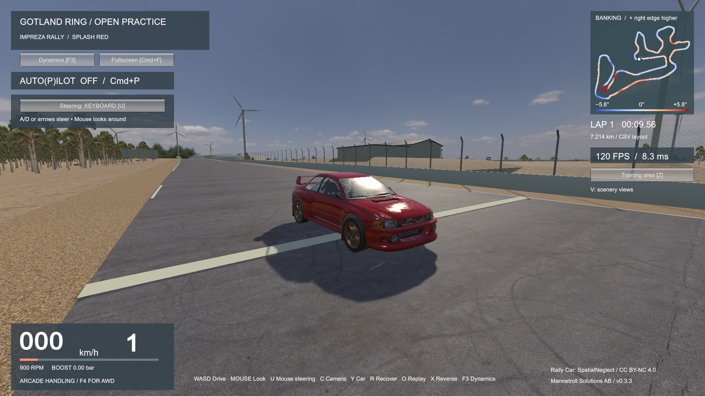

# GRWeb — deploy the game on your own site

**A rally Impreza. A Baltic circuit. An open practice session.**

Download a ready-to-run browser game and host it on your own web server. No Unity installation or build tools are needed. This repository contains deployment documentation, configuration and credits; the compiled game is attached to each release.

**[Play the demo](https://mannetroll.com/grweb/)** · **[Download v0.2.1](https://github.com/mannetroll/grwebdeploy/releases/tag/v0.2.1)** · **[Installation guide](INSTALL.md)**

## Download and deploy

1. Download [GRWeb-v0.2.1.tar.gz](https://github.com/mannetroll/grwebdeploy/releases/download/v0.2.1/GRWeb-v0.2.1.tar.gz) or [GRWeb-v0.2.1.zip](https://github.com/mannetroll/grwebdeploy/releases/download/v0.2.1/GRWeb-v0.2.1.zip), plus [SHA256SUMS](https://github.com/mannetroll/grwebdeploy/releases/download/v0.2.1/SHA256SUMS). Each archive is approximately 206 MiB; both contain the same deployable folder.
2. Verify the checksum and extract the archive.
3. Upload the **whole `GRWeb-v0.2.1/` folder's contents** to your site's game directory, preserving the `Build/` subfolder and notices.
4. Configure your server using [INSTALL.md](INSTALL.md), then visit your game's HTTPS URL and click **Start driving**.

The guide includes an Nginx snippet, AlmaLinux SELinux setup, deployment checks, updates and rollback. Other static web hosts can serve the same files with the headers described there. The game has no application server, database or account service.

Use the named game archives under **Releases → Assets**. GitHub's automatic **Source code (zip/tar.gz)** downloads contain this documentation repository, not the game. Downloading or cloning this repository alone does not install the game.

## Play

The game has been tested in desktop Chrome, macOS Safari and Safari/Chrome on iPhone. Performance depends on the device and browser. The first visit downloads substantial game data; give it time to prepare the circuit. Open the game through HTTP/HTTPS, rather than double-clicking `index.html`.

**Desktop:** click **Start driving** to enable sound and mouse control.

| Key | Action |
|---|---|
| W / Up, S / Down | Gas, brake |
| A / D or Left / Right | Steer |
| X | Reverse |
| C | Change camera |
| Y / T | Change car / paint |
| U | Toggle mouse steering |
| R / Home | Reset car / reset lap |
| P | Toggle autopilot |
| G | Dynamics and view/sound settings |
| H | Switch AWD physics / arcade handling; restarts the lap and clears its best time |
| F | Fullscreen |
| M | Toggle sound |
| Z / V | Training area / scenery views |
| O | Open or leave Record Lap |
| Escape | Release mouse / pause |
| F2 | Download a screenshot |

**Record Lap** plays the supplied reference lap; it does not record your drive. During playback, **Space / Escape** pauses or resumes, **Home** restarts and **O** returns to your saved drive.

**iPhone:** landscape gives a wider view. Use the left slider for gas/brake and the right slider for steering. Lift either thumb to return that control to neutral. Speed, gear, FPS and lap time appear at the top. **Menu** provides reset, camera, car, sound, autopilot, settings and Record Lap. Menu actions take effect immediately and return to driving. Switching apps or rotating pauses the game.

## Credits and permitted use

This is an **unofficial fan-made prototype**, not affiliated with or endorsed by GotlandRing, Subaru Corporation or their affiliates.

The included car models are licensed under **CC BY-NC 4.0**. Keep the attribution and notices with the game; builds containing these assets are for noncommercial use. The MIT licence for original project software does not replace the separate asset, data or Unity runtime terms.

- [Third-party notices](THIRD_PARTY_NOTICES.md)
- [Car and environment credits](docs/ASSET-CREDITS.md)
- [Track and geospatial data licences](DATA_LICENSES.md)
- [Original software licence](LICENSE)

Release archives retain the accompanying data and provenance files. There are no C# files, Unity project assets or source history in this distribution repository. The runnable downloads include generated JavaScript, WebAssembly and game data.
